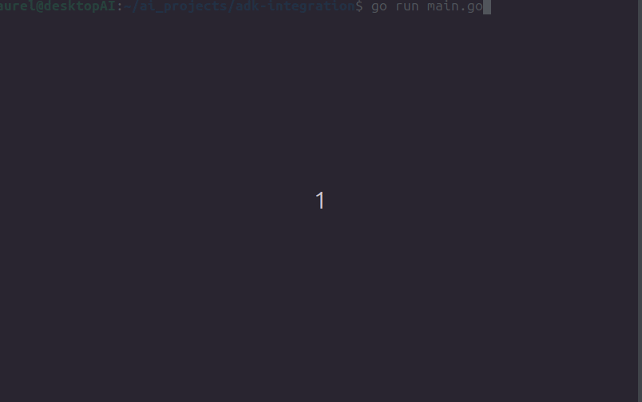

# Symbolic AI Agent: Google ADK meets Modular A* Planning

An experimental proof-of-concept demonstrating how to bridge **probabilistic generative AI** (Google Agent Development Kit & Gemini) with **symbolic deterministic reasoning** (a decoupled, high-performance A* search engine) in Go.

Instead of relying purely on LLM reasoning for spatial navigation or multi-step execution (which can suffer from hallucinations), this agent delegates mathematical search and constraints to a hardcoded symbolic engine, using Gemini as the conversational orchestrator and interface.

---

## 🏗️ Architecture & Project Structure

The project follows a strict **Separation of Concerns** design, ensuring that the search algorithm is completely agnostic to the problem domain and the LLM agent layer:

```text
adk-integration/
├── .gitignore
├── LICENSE
├── go.mod
├── go.sum
├── README.md
├── main.go                     <-- Entry point & terminal animation runner
├── search/
│   └── astar.go                <-- Generic A* search engine (Priority Queue & Node evaluation)
├── domains/
│   └── maze.go                 <-- Problem domain (Grid-based maze, obstacles, Manhattan heuristic)
└── adapters/
    └── adk_tools.go            <-- Tool adapter bridging the symbolic solver to Google ADK
    
search/: The core algorithmic engine. Implements generic A* graph search using Go's container/heap.

domains/: Defines specific rules, states, and heuristics (e.g., grid map pathfinding, boundary checks, and wall avoidance).

adapters/: Exposes the deterministic solvers as structured tools consumable by the LLM agent.

🚀 Visual Demonstration
The agent navigates a text-based grid maze (S = Start, E = Exit, # = Wall, * = Traveled Path) avoiding all obstacles with 100% mathematical optimality:



